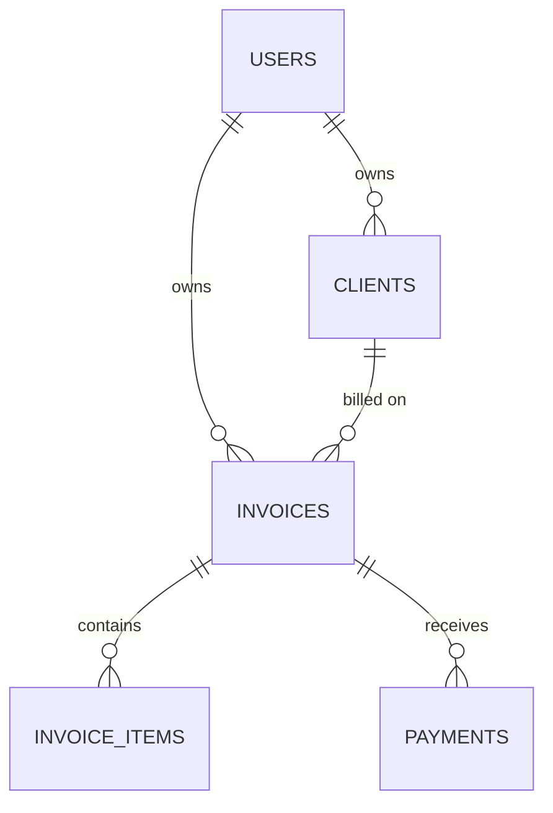

# Invoice App | Laravel Web Application
**Status:** In-Development (MVP)

---

## 01. THE PROBLEM & SOLUTION
* **The Challenge:** Freelancers and small businesses lose track of who owes them money, which invoices were sent, and which are overdue, often across spreadsheets and email threads.
* **The Solution:** A multi-user Laravel application that manages clients, invoices, payments, and PDFs in one place, with rules that keep invoice numbers unique and lock sent invoices against edits.

---

## 02. ARCHITECTURAL DESIGN
The app is split into layers so each file has one job:

* **Livewire components** handle UI state and call actions.
* **Actions** hold business logic and database writes, one job per class (for example `CreateInvoice`, `RecordPayment`).
* **Services** hold pure calculations, such as `InvoiceCalculator`, with no database access.
* **Policies** decide who can view, edit, send, or pay an invoice.
* **Controllers** stay thin. The only one is the PDF download.

### Entity-Relationship Diagram

Key design decisions:
* Money is stored as `decimal(12,2)`, never as floats.
* `invoices` has a unique index on `(user_id, sequence)`, so each user's numbers can't repeat.
* `clients` to `invoices` uses `restrictOnDelete`, so the database refuses to delete a client who has invoices.
* Totals are stored on the invoice as a snapshot, so a PDF from last month still shows the amounts it was issued with.

---

## 03. TECH STACK & INFRASTRUCTURE
* **Core:** PHP, Laravel, Livewire, Blade, Tailwind CSS, Vite
* **Database:** SQLite (default for local development). MySQL or PostgreSQL work by changing `.env`.
* **Packages:** Laravel Breeze (authentication), barryvdh/laravel-dompdf (PDF generation), Pest (testing)
* **Infrastructure:** GitHub Actions runs the test workflow in `.github/workflows/tests.yml`. Hosting is not yet defined.
* **Security:** Laravel authentication, CSRF protection, bcrypt password hashing, and policy-based authorization. Rate limiting and security headers are not configured yet.

---

## 04. CORE LOGIC & FEATURES
* **Clients:** Create, edit, and delete clients. Each user sees only their own. A client with invoices can't be deleted.
* **Invoices:** Draft invoices with line items, discount, and tax, with totals updating live as you type. Status flows from draft to sent to paid. Only drafts can be edited or deleted.
* **Payments:** Record payments against sent invoices. Overpayments are rejected, and the invoice is marked paid when the full total is received.
* **Overdue tracking:** Sent invoices past their due date with a balance remaining are flagged and can be filtered.
* **Email:** Sending an invoice emails the client when they have an address on file. In development, emails are written to the log.
* **PDF:** Download any of your invoices as a PDF.

---

## 05. TECHNICAL CHALLENGES OVERCOME
* **Issue:** Invoice totals could drift away from their line items after edits.
  **Resolution:** Totals are recalculated in the same database transaction as the item changes, so they're always consistent.

* **Issue:** Old invoices could change when item prices change later.
  **Resolution:** Each invoice stores its own totals and line amounts as a snapshot, so issued amounts stay fixed.

* **Issue:** Two requests could create the same invoice number at once.
  **Resolution:** A unique database index on `(user_id, sequence)` makes the database reject duplicates. Currently a conflicting request fails instead of retrying. Automatic retry is planned.

Performance metrics have not been measured yet.

---

## 06. API & DX
* **Public API:** None yet. The app is built on server-rendered Livewire pages, not a JSON API.
* **Main routes:**

| Route | Purpose |
|---|---|
| `/clients` | Client list |
| `/clients/create` | New client |
| `/invoices` | Invoice list with search and status filter |
| `/invoices/create` | New invoice |
| `/invoices/{invoice}` | Invoice detail, send, and payments |
| `/invoices/{invoice}/pdf` | PDF download |

* **Error handling:** Validation errors appear under the relevant field. Business-rule errors, such as deleting a client with invoices, appear as messages on the page.
* **Planned:** A JSON API with actionable error payloads and documentation links.

---

## 07. TESTING & QUALITY
* **Coverage:** Not measured yet. To check it locally, install Xdebug or PCOV, then run `php artisan test --coverage`.
* **Tools:** Pest, Livewire's testing helpers, and `RefreshDatabase` for feature tests.
* **Test areas:** Unit tests for the calculator. Feature tests for client and invoice actions, the invoice form, policies, payments, and PDF access.
* **Workflow:** GitHub Actions runs `php artisan test` on pushes and pull requests.

---

## 08. SETUP
1. `git clone https://github.com/david-fred/invoice-app.git`
2. `cd invoice-app`
3. `composer install`
4. `cp .env.example .env` and then `php artisan key:generate`
5. `touch database/database.sqlite` (SQLite database file)
6. `npm install`
7. `php artisan migrate`
8. `npm run dev` (keep this running)
9. In a second terminal, `php artisan serve`, then open http://127.0.0.1:8000

Set `MAIL_MAILER=log` in `.env` so emails are written to `storage/logs/laravel.log`.

---

## 09. LICENSE
MIT
